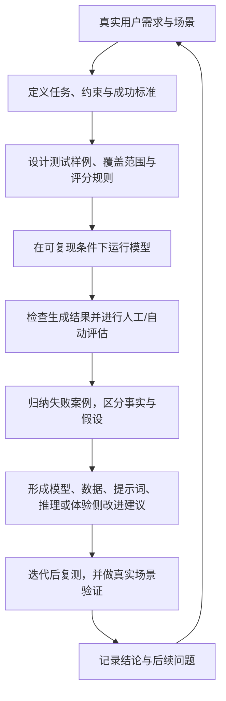

# 多模态生成模型产品与评测：个人学习笔记

> 这是一份面向学习者的通用整理，不是任何公司、实验室或项目的官方材料。内容聚焦可公开讨论的方法；不包含具体项目名称、内部安排、人员与协作入口、时间节点、未公开指标或内部链接。

## 1. 产品工作的核心：把能力变成可判断、可改进、可使用的结果

多模态模型产品工作不只是收集需求或展示好看的样例，而是连接用户问题、模型能力、评测证据与真实使用。一个清晰的产品问题通常要回答：

- 用户想完成什么，输入和使用环境是什么？
- 什么结果算成功，哪些约束不能被牺牲？
- 需要什么样的任务、样例和评测标准来判断效果？
- 失败更可能来自输入理解、提示词处理、生成模型、数据、推理链路还是产品交互？
- 改进后如何验证，并让用户或业务方实际体验？

## 2. 通用工作闭环

关键不是机械地完成每一步，而是让证据、结论和下一步动作能够交接，避免评测报告只留下分数、没有后续验证。

## 3. 生成模型链路的入门视角

多模态生成结果通常由多个环节共同决定。评测时应尽量区分各环节影响，而不是看到最终视频不理想就直接归因于“模型不行”。

- **输入与提示词处理**：用户意图是否被正确保留？约束、主体、动作、风格和镜头要求有没有被遗漏或改写偏？
- **生成模型**：模型是否按要求生成内容？人物、物体、动作、空间、风格和跨帧一致性如何？
- **数据与训练**：失败是否集中在某类题目、场景或表现形式，提示数据覆盖可能存在缺口？单个案例不足以证明根因。
- **推理与服务**：相同输入在不同运行设置下是否稳定？等待时间、资源限制、异常和输出质量是否满足使用需求？
- **产品体验**：用户能否理解输入方式、控制参数、生成状态、结果限制和反馈入口？

常见术语可以先按“在链路中的作用”理解：VAE 常用于表示或重建环节；提示词处理模块负责整理用户意图；生成模型负责合成结果；超分辨率模块用于提升已有图像或视频的空间分辨率。不同系统实现可能不同，术语不应替代对实际链路的确认。

## 4. 评测设计：先想清楚要回答什么问题

### 4.1 版本对比与能力诊断

- **版本对比**回答“在定义好的任务和标准下，哪个版本更符合目标”。适用于相对质量判断和版本选择。
- **能力诊断**回答“哪些具体要求已能完成、哪些仍会失败、失败集中在哪里”。适用于发现短板和提出迭代方向。

两者可以互补，但不要用一个总体偏好分数替代对具体能力的诊断。

### 4.2 建立有代表性的任务集

测试任务应来自真实需求、用户反馈、已知失败和合理的边界探索。覆盖设计可考虑：

- 输入类型与复杂程度；
- 语言、提示词表达方式和描述长度；
- 主体数量、动作类型、交互关系和镜头变化；
- 场景、光照、构图、风格及其组合；
- 参考素材条件与输入限制；
- 简单、常见、困难和边界任务。

边界探索用于了解能力变化趋势，不等于对外承诺支持。测试集也要检查重复度、覆盖偏斜、无效题和可能泄漏到训练流程的风险。

### 4.3 把主观感受写成可执行标准

评价标准应让不同评测者知道观察什么、如何判断、什么情况算不满足。对每个维度尽量给出：

1. 维度定义和适用范围；
2. 可观察的判断点；
3. 正向、临界和失败示例；
4. 与相邻维度的边界；
5. 无法判断、输入无效或生成失败时的处理方式。

标准初稿需要通过试评、分歧复盘和修改来验证可理解性与一致性。不要把未经验证的模型生成文本直接当作最终评分规范。

### 4.4 对比条件与可复现性

比较模型或版本时，记录并尽量统一输入、提示词处理方式、推理参数、采样设置和输出约束。明确基线为什么适合回答当前问题；若条件不一致，应说明它对结论的影响。对有随机性的生成任务，可进行重复运行并同时报告典型表现与波动，不能只挑最好的一次。

## 5. 结果分析：从“好不好看”走向“哪里、为什么、怎么办”

对视频生成结果，可以分别观察：

- **内容遵循**：主体、动作、场景和关键约束是否出现；
- **视觉质量**：清晰度、构图、光影、色彩和伪影；
- **时序一致性**：主体身份、物体属性、空间关系和风格是否随时间稳定；
- **动作合理性**：运动是否连贯，是否符合基本物理直觉；
- **镜头表达**：机位、运动、节奏和叙事视角是否服务于任务；
- **音视频表现**：如任务涉及音频，分别评估内容、同步和整体体验；
- **可用性**：结果是否达到目标场景可接受的质量、稳定性和等待成本。

对失败案例保留原始需求、实际输出、受影响维度、可观察证据和待验证解释。区分“看到什么”与“推测原因”，再把问题路由给提示词处理、模型、数据、推理或产品体验的相应环节。

## 6. 美学数据与专项能力建设

当问题反复出现在同一类能力上时，可以考虑建设专项，而不是因单个不理想样例立即下结论。专项工作可以从以下步骤开始：

1. 说明能力定义与目标使用场景；
2. 收集有代表性的正例、反例和边界案例；
3. 将抽象审美词汇拆解为可观察要素；
4. 形成任务、标注说明或数据筛选标准；
5. 用小范围试评检查标准能否稳定执行；
6. 将结论转化为数据补充、模型改进或产品建议；
7. 迭代后用相同标准复测。

图像与视频美学可以关注构图、主体关系、光影、色彩、空间、镜头运动、节奏、动作和风格一致性。数据整理应保持来源可追溯，确认素材授权和使用边界，并关注多样性，避免数据过度集中造成新的偏差。

## 7. 体验设计与 Showcase

模型能力展示应让用户理解“这个案例要展示什么能力”，而不是只陈列偶然生成的漂亮结果。设计时可检查：

- 目标用户和要展示的能力是否明确；
- 输入、参数、生成状态和结果说明是否易懂；
- 样例是否有代表性、能否稳定复现；
- 失败结果能否被记录并用于改进；
- 是否清楚说明能力边界，避免把单次最佳结果包装成稳定承诺。

## 8. 业务场景验证

把业务方的“效果不理想”转成有证据的问题：补齐真实输入、目标用户、使用环境、成功标准和典型输出，再判断主要限制来自质量、可控性、等待时间、成本、接入方式还是合规要求。选择改进路径时，先评估较轻量的提示词、推理或体验调整是否足够；若需要数据或模型改进，再定义验证方法和交付边界。

## 9. 可复用工作模板

### 评测计划

- **评测问题：**本次要支持什么判断？
- **目标用户与场景：**谁在什么条件下使用？
- **任务与输入：**测试哪些代表性要求？
- **对比对象与运行条件：**基线、版本和参数如何保证可比？
- **评测维度与标准：**观察什么，如何打分？
- **样本覆盖：**常见、困难、边界及语言/风格分布如何安排？
- **质量控制：**如何试评、复核分歧和检查数据？
- **结果形式：**汇总指标、典型案例和不确定性如何呈现？
- **后续验证：**谁处理哪些问题，如何确认改进有效？

### 失败案例记录

- 原始任务与输入；
- 模型版本及必要运行条件；
- 预期表现与实际结果；
- 可观察的失败现象及对应维度；
- 已确认事实与尚待验证的归因；
- 建议排查环节及复测方式。

### 体验或 Demo 方案

- 目标用户和核心能力；
- 输入方式、参数与输出呈现；
- 示例选择依据和复现方法；
- 能力限制、失败处理和反馈回收；
- 如何判断体验是否帮助用户完成任务。

## 10. 术语速览

| 术语 | 入门理解 |
| --- | --- |
| Benchmark | 一组围绕目标能力组织的评测任务、数据和规则 |
| Task | 一项明确输入、目标与成功条件的测试任务 |
| Baseline | 用于比较的参考模型、版本或方法 |
| Rubric | 把评价维度和判断规则写清楚的评分规范 |
| Regression evaluation | 检查已有能力在更新后是否退化 |
| Capability evaluation | 探索系统目前能做什么、短板在哪里 |
| Showcase | 用代表性案例解释模型能力与限制的体验材料 |

## 11. 学习时的检查清单

- 我能否用一句话说明本次评测要支持的决策？
- 成功标准是否可观察，而不是只写“效果好”？
- 样本是否覆盖真实使用及关键边界？
- 比较条件是否足够公平且可复现？
- 评分规则是否经过试评，分歧是否有处理方式？
- 结论是否由案例和数据支持，并明确不确定性？
- 建议是否指向可执行的下一步与复测方式？
- 公开分享前是否确认素材授权、保密边界和个人信息已妥善处理？

---

本笔记是个人学习材料，不构成特定模型、组织或产品的官方流程说明。实际工作应以项目授权的文档和负责人确认的信息为准。
