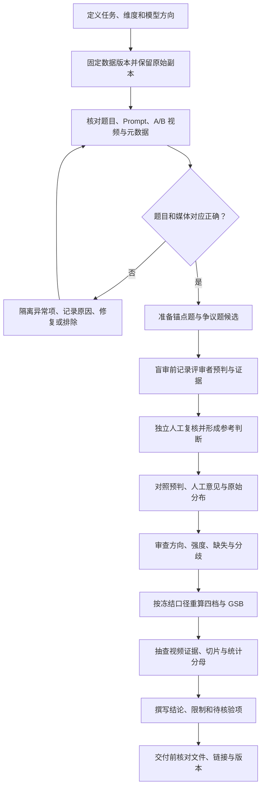

# 视频偏好评测：从数据检查到结果交付的质检闭环

这份指南补充成对视频评测中的**流程质检**：不仅看最后的 GSB 数值，也检查题目、视频、人工判断、统计口径和报告证据能否彼此对上。

> 本页是通用学习材料，不对应某一家公司、模型或实际批次。示例规则需按具体任务预先约定；人员级判断和最终处理必须由人复核。

## 质检闭环



## 1. 先把评测口径写清楚

在查看结果前，记录本轮要回答的问题、题集范围、评价维度、模型 A/B 对应关系、四档含义、有效记录标准、聚合方法和报告范围。涉及版本比较时，明确哪些结论属于当前样本，哪些需要留出数据独立验证。

不要沿用上一批的模型名、题号、阈值或人员名单。相似的文件名并不保证它们来自同一个导出版本。

## 2. 固定源数据，先做映射审计

保留只读原始副本，在分析副本上处理。为每个输入记录来源版本、导出时间、文件校验信息和处理步骤。检查：

- 题号、完整 Prompt 与 A/B 媒体是否属于同一道题；
- 媒体能否打开，实际内容是否与记录的模型方向一致；
- 标签是否合法，是否存在空值、重复、错行或缺失；
- 计数是否区分题目数、评审人数、原始记录数和题目×维度数；
- 摘要表能否由底层记录复算，而不是把摘要当作唯一事实来源。

发现错链或错配时，隔离受影响单元并记录处理原因。链接可访问，不等于视频和题目匹配。

## 3. 设计人工参考判断（GT）

候选题应覆盖清晰胜负、相近/平局和有代表性的争议案例。按“题目×目标维度”选择，尽量避免同一原题被重复计作多个独立检查项。参考判断应由人工依据明确标准确认；评审前应保留每位评审的独立判断和可观察证据。

如果要分析模型或人员与人工参考判断的一致性，应在收集参考答案前封存待比较方的预判。事后补写的预判不能当作事前结果。没有人工参考判断时，只能报告候选题或描述性统计，不要把共识或多数票包装成已验证真值。

## 4. 把分歧、平局和无效判断分开

统一四档方向，并在所有表格中显式说明方向。例如：

| 标签 | 含义 |
|---|---|
| `G / Good` | 模型 B 明显更好 |
| `As good` | 两边都较好 |
| `As bad` | 两边都有明显问题 |
| `B / Bad` | 模型 A 明显更好 |

`As good` 与 `As bad` 都可归入相近/无明确胜负方向的 `Similar` 统计，但细分分布仍要保留。`As bad` 不代表某一个模型单独失败。

还要区分：

- **平局/相近**：评审认为两边在该维度上没有实质差别；
- **无法判断**：媒体失效、任务不清或证据不足；
- **无共识**：多人判断未达到预先规定的聚合条件。

三者含义不同，不应互相替代，也不应为凑齐结果自动填成平局。

## 5. 用 GSB 汇总前，核对权重和分母

若题目有效票数不同，可在每个维度内先让每道题总权重相同。第 `i` 题有 `n_i` 条有效票时，每票权重为 `1/n_i`。此时应验证每道有效题的权重和为 1；没有有效票的题目单独披露。

令 `G` 和 `B` 分别表示明确胜负的加权质量，`Similar = As good + As bad`：

```text
GSB = (G + 0.5 × Similar) / (B + 0.5 × Similar)
```

必须先固定模型方向。按该定义，`GSB > 1` 表示模型 B 偏优，`GSB < 1` 表示模型 A 偏优。每个维度都要核对四档加总、百分比闭合、题目权重、有效分母和零分母情形。不要平均每题单独算出的 GSB 来代替题目等权汇总。

## 6. 人员质量诊断不能自动变成淘汰决定

可以将共识一致性、标签多样性、强弱档使用、同方向下的强度差异和重复题一致性作为**需要复核的信号**。指标必须同时给出可比样本数和参照范围；小样本或类别严重不平衡时尤其要谨慎。

单一异常指标不足以证明某人标错、机械作答或不具备能力。若业务确实需要人员级处置，应预先说明适用规则，结合原始证据、敏感性分析和人工复核；自动化统计只提供参考，不直接决定个人资格。

## 7. 从指标结论回到视频证据

证据链应是：**评测维度 → 相关反馈或标签 → 实际观看/听取的视频现象 → 具体题目与时间段**。

只有实际查看过相应片段，才能把现象写成已核实的 Badcase。未看视频时，应写“数据提示需复核”，不能根据 Prompt、低分或模型名称补造画面问题。声音与音画同步结论也必须实际听取或核验。

把任务类别、评审选择的影响因素、视频中观察到的问题分开记录。它们不是同一层级，也不能仅凭相关性推断因果。跨题归纳应有多个已核实例子支撑；单一例子标为个案。

## 8. 区分“已确认汇总”和“底层复算结果”

报告中的每个数字都应注明统计范围、分母、过滤口径、权重和数据版本。用户确认某个汇总文案，不等于底层数据已被独立复算。若复算值不同，应并列记录两种来源并解释差异，不静默覆盖，也不反向调整底层记录去匹配摘要。

对“显著提升”“能力边界”“因果”等强结论，必须有相应验证设计支持。小样本切片、训练中使用过的题集和按这些题目筛选出的样本，只适合作为诊断，不应冒充独立盲测。

## 9. 交付前检查

- [ ] 模型 A/B 方向、标签含义和 rubric 版本已明确。
- [ ] Prompt、题号、媒体和模型映射逐项对齐。
- [ ] 原始文件保留，分析修改有版本和审计记录。
- [ ] GT 来源、人工确认状态、分歧和无效项有记录。
- [ ] 四档、Similar、GSB、有效题数及权重可以复算。
- [ ] 报告结论有已观看/听取的证据；未知项被明确标为待核验。
- [ ] 独立验证集与训练/筛选中使用的样本区分清楚。
- [ ] 对外材料不含真实人员记录、内部路径、带签名媒体链接或未获公开许可的样例。
- [ ] 文件、链接、截图与页面写入状态已实际打开核验；未完成项如实说明。

## 与本手册其他内容的关系

本页解释质检闭环和证据边界；具体标签定义、题目等权、人员指标与报告模板继续参考本手册的 [T2V/T2AV 成对视频评测](pairwise-video-evaluation.md) 与 `analyze-pairwise-video-evals` 方法页。它是学习指南，不是已运行验证的自动化程序。
